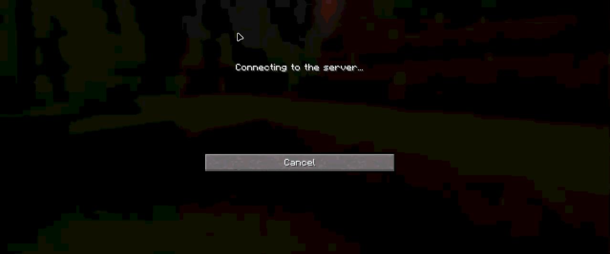
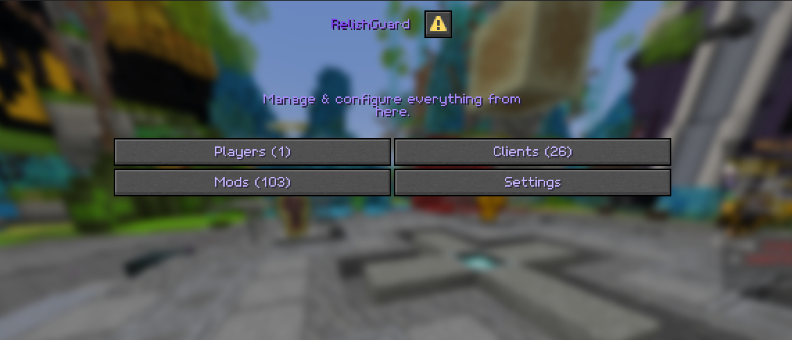
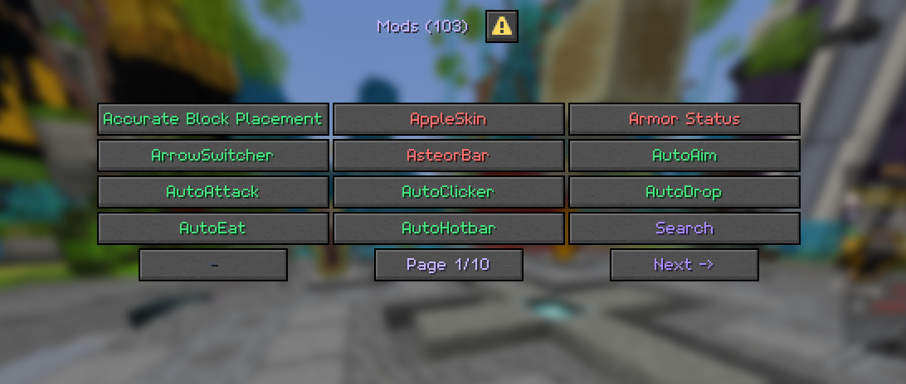

## 🛡️ Client integrity & prohibited-mod detection for Paper servers

---

## 🌟 **Why Choose RelishGuard?**

RelishGuard detects hacked clients and prohibited mods **during the join handshake** — before a cheater reaches spawn. It reads what the client sends over the protocol (plugin channels, brand strings, translation-key requests) instead of guessing from behavior, names the exact client or mod found, and keeps legitimate QoL and map mods working. Built for modern Paper servers with performance and reliability in mind.

### ✨ **Key Highlights**

🚪 **Caught before spawn** — probes fire during Join Game, often before the player reaches the world  
🏷️ **Names the cheat** — "Wurst", "Meteor", "Xray", not a vague "suspicious player"  
🎛️ **Per-mod control** — green = enforced, red = allowed; legit mods work by default  
🖥️ **Staff dashboard** — `/rg` opens a native dialog: inspect, kick, ban, review logs  
📜 **Violation history** — every detection recorded in SQLite, survives restarts  
📢 **Discord alerts** — detections and punishments reported to your staff channel live  
✅ **Legit-mod friendly** — maps, Jade, camera, and QoL mods allowed out of the box  

---

## 📋 **Requirements**

| Component | Requirement |
|-----------|-------------|
| **Minecraft** | 1.21+ (Paper dialogs) |
| **Server** | Paper, Purpur, or Paper-based forks — **Folia supported** |
| **Java** | 21+ |
| **Dependencies** | PacketEvents (required), GrimAC (optional trigger source) |

---

## 🚀 **Features Overview**

### 🔍 **Detection Layers**

| Layer | What it catches |
|---|---|
| **Anvil rename probe** | Client mods with language files — fires on Join Game via the MC-265322 inventory-title quirk. The sole translation-key detector. |
| **Channel inspector** | Plugin-message channel registrations + client brand strings — catches Fabric/Forge/Quilt loaders and hacked clients (Wurst, Vape, Meteor, LiquidBounce…). |
| **Brand spoof check** | Vanilla-ish brand combined with loader channels. |
| **Inventory click burst** | Inhuman container-click rates (autoclicker-style automation). |
| **Anticheat hook** | Runs the probe pipeline when GrimAC flags a player; optional punishment at a VL threshold. |

> ⚠️ **Honest limits:** purely client-side modules with no channel, brand, translation key, or packet signature (Fly, Reach, some ESP/xray packs) cannot be name-detected — no plugin can do that. GrimAC behavioral flags and Paper anti-xray cover those cases.

### 🖥️ **Staff Dashboard (`/rg`)**

Bare `/rg` opens a native dialog with everything in one place:

- **Players (n)** — paginated online list; hover for ping/brand/status, click to inspect
- **Clients (n) / Mods (n)** — every detected signature as a toggle; green = enforced, red = allowed
- **Search** — filter clients and mods by name, paginated results
- **Inspect** — brand, ping, detected mods, live probe, kick / ban / ban-ip, violation log
- **Settings** — debug, auto-punish (kick/ban/ban-ip), auto-probe (on join / on anticheat flag), Discord webhook, language
- **Violation Log** — paginated record of every detection with layer and brand

### 💾 **Persistence**

`config.yml` holds the license key and every runtime setting (same pattern as the other Relish plugins). Admin-facing state lives in:

- `plugins/RelishGuard/config.yml` — license key + all runtime settings
- `plugins/RelishGuard/data.db` — SQLite: violation history + per-mod toggles
- `plugins/RelishGuard/lang/en.yml` — every player/staff-facing string, including all dialog text

Detection rules, probe keys, channel lists, and timings are hardcoded in Java (`DetectionRules` / `RelishConfig`) — they cannot be broken by accidental edits.

### 🌍 **Languages**

Copy `lang/en.yml` to `lang/es.yml` (or any code), translate the values, then pick it in **Settings → Language**. Missing language files fall back to `en`.

### 📢 **Discord Integration**

Enable in **Settings → Discord**: webhook URL + server name (defaults to the server name). Detections, auto-punishments, and manual bans all post embeds with player, brand, layer, and violation details.

---

## 🎮 **Commands**

| Command | Permission | Description |
|---|---|---|
| `/rg` | `relishguard.gui` | Open the staff dashboard |
| `/rg inspect <player>` | `relishguard.inspect` | Player inspection dialog |
| `/rg settings` | `relishguard.admin` | Open settings directly |
| `/rg check <player>` | `relishguard.check` | Run the rename probe manually |
| `/rg reload` | `relishguard.admin` | Reload messages, toggles, and settings |
| `/rg help` | — | Command list |

### 🔑 **Permissions**

| Node | Default | Description |
|---|---|---|
| `relishguard.admin` | op | Full access (inherits all below) |
| `relishguard.gui` | op | Open the dashboard |
| `relishguard.inspect` | op | Inspect players |
| `relishguard.check` | op | Run live probes |
| `relishguard.bypass` | false | Detections still recorded, but no Discord alerts or punishment — for trusted players |

---

## ⚙️ **Configuration**

### **Settings (`config.yml`)**

| Setting | Values | Default |
|---|---|---|
| `debug` | on/off | off |
| `auto-punish` | on/off | on |
| `punishment-type` | `kick` / `ban` / `ban-ip` | `kick` |
| `auto-probe-on-join` | on/off | on |
| `on-anticheat-flag` | on/off | on |
| `discord.enabled` | on/off | off |
| `discord.webhook-url` | URL | empty |
| `discord.server-name` | text | server name |
| `language` | lang file code | `en` |

Settings live in `config.yml` — edit the file directly or change them in the **Settings** dialog, which writes straight back to the file.

### **Mod toggles**

Every signature in **Clients** and **Mods** can be flipped individually. Legitimate QoL, map, inventory, camera, and info mods (Xaero's, JourneyMap, Litematica, Jade, ItemScroller, etc.) are **allowed by default**; everything else enforces. State persists in `data.db`.

### **`lang/en.yml` highlights**

- `kick.message` / `kick.discord-url` — kick template + Discord footer
- `punish.broadcast` — styled server broadcast on punishments
- `reason.*` — detection reason strings incl. all anticheat offense phrases
- `dialog.*` — every dialog title, button, tooltip, and body line
- `alert.*`, `check.*`, `ban.*` — command and alert messages

---

## 🔌 **Integrations**

- **PacketEvents** — required; channel inspection, early kicks, rename probes
- **GrimAC** — optional; flagged players trigger the probe pipeline (`on-anticheat-flag`)
- **Discord webhooks** — detection/punishment embeds
- **Folia** — fully region-scheduler compatible

---

## 🧠 **Detected Coverage — 100+ clients & 100+ mods**

**Hacked clients:** Wurst, Meteor, Vape, Future, Delta, ThunderHack, Abyss, Nitrogen, RusherHack, Konas, Sigma, Midas, Doomsday, Potato, Radium, Impact, LiquidBounce, NextGen, Xenon, Fuzion, FDP, Aristois, Prodigy, Eternium, BleachHack, EvoHack…

**Mods:** AutoTotem family, AutoClicker/AutoAttack, KillAura, ESP, Xray variants, SeedCrackerX/Seed Viewer, Freecam variants, Baritone, ElytraSwap variants, inventory/camera/QoL mods (allowed by default), and many more.

**Blind spots:** client-local modules with zero protocol footprint (pure Fly/Reach/aim-assist inside an undetected loader) — covered by GrimAC behavior checks and Paper anti-xray, not by name.

---

## 📄 **License**

**RelishGuard is proprietary software. All rights reserved.**

### License Types

#### ⏳ Trial Version
- 14-day free trial, requested automatically on first boot — one per device
- Full feature set during the trial

#### ⭐ Premium Version
- Requires a valid license key from [Relish Plugins](https://relishes.studio/?buy=relish-guard)
- Paid keys start with `RL-` (trial keys `TRL-`), pasted into `license-key` in `config.yml`
- Validated on startup and every 30 minutes; license responses are RSA-signed

For full license terms, see the [LICENSE](https://github.com/iM5LB/RelishGuard/blob/master/LICENSE) file.

---

**Made with ❤️ by M5LB**

