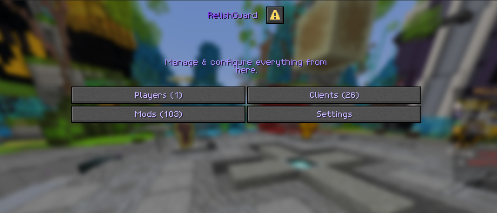
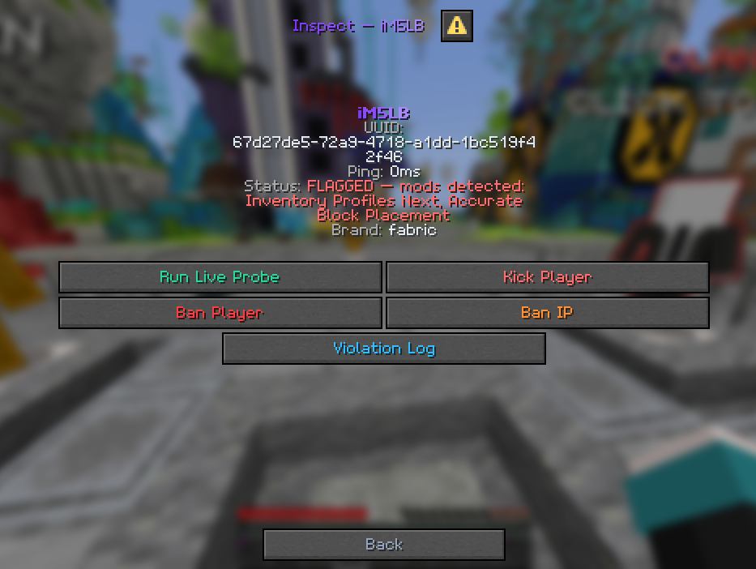
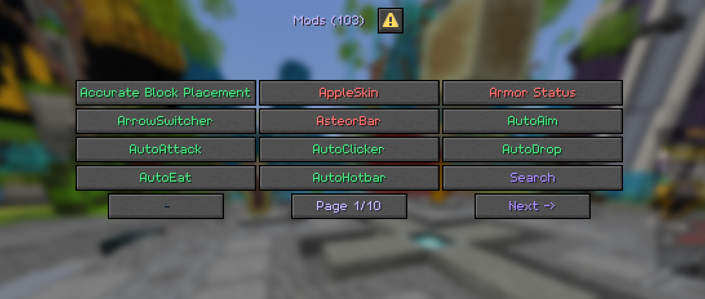
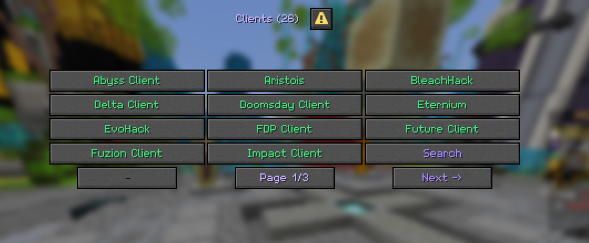

# Staff Dashboard

`/rg` opens the Paper Dialog dashboard — no GUIs inventories, no menus to learn. Everything saves instantly; there is no apply step.

## Main dialog

- **Players (n)** — paginated online-player grid; hover shows ping, brand, and status; click to inspect
- **Clients** — client registry with enforcement toggles
- **Mods** — mod registry with enforcement toggles
- **Settings** — runtime configuration

Only **Back**, **Close**, and **Esc** dismiss dialogs — spacer and pager buttons re-render in place.

## Inspect (`/rg inspect <player>`)

Per-player screen showing:

- Client brand and registered channels
- Detected clients/mods with enforced/allowed state
- Live rename-probe results ("Run Live Probe" button)
- Recorded violations count → **Violation Log** (paginated history)
- Actions: **Kick Player**, **Ban Player**, **Ban IP** (reason prompt, cancels return to inspect)

## Mods & Clients lists

- Search button filters by mod **or** client name
- Toggle buttons flip enforcement instantly (green = enforced, red = allowed)
- Disabled detections stay visible — they just don't punish

## Settings

| Entry | Controls |
|-------|----------|
| Debug | Verbose `[RG]` console logging |
| Auto-Punish | Toggle + punishment type: `KICK`, `BAN`, or `BAN-IP` (vanilla punish commands) |
| Auto-Probe | Probe **on join** and/or **on anticheat flag** — independent toggles |
| Discord | Enabled toggle, webhook URL, server name (empty = actual server name) |
| Language | Picker listing every `lang/*.yml` — switches all dialog text live |
