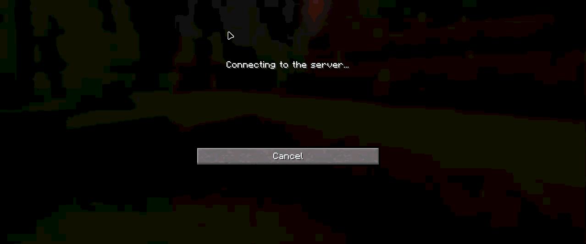

# Detection

RelishGuard detects prohibited clients and mods through several independent layers. Every detection is recorded as a violation with its layer, client brand, and mod name.

## Detection layers

| Layer | What it catches |
|-------|-----------------|
| `brand` | Client brand strings (Wurst, Meteor, etc.) reported in the client-brand packet |
| `channels` | Plugin-message channels — hacked clients and mods register custom channels on join |
| `rename-probe` | The anvil-rename translation-key probe (MC-265322) — catches mods that register lang keys but no channel or brand |
| `anticheat` | When GrimAC flags a player, the rename probe runs automatically for deeper inspection |
| `click-burst` | Inventory-click burst heuristic for autoclicker-style clients |

## The rename probe

The most powerful layer. On join (or when the anticheat flags a player) RelishGuard opens a fake anvil rename window and sends a crafted item name containing up to 4 translation keys per sign line. A modified client resolves those keys through its registered mods and reports back which mods answered — revealing mods that have **no** server-visible channel, brand, or packet.

- Keys are obfuscated per-session so clients can't pre-emptively whitelist them
- Stealth: works on vanilla clients without any visible side effects
- Covered by hundreds of translation keys for known clients/mods — all hardcoded in `DetectionRules`

## What is enforced vs allowed

Every detected name has a per-mod toggle in **Mods** / **Clients**:

- **Enforced (green)** — violations kick/punish per your Auto-Punish settings and alert Discord
- **Allowed (red)** — still detected and logged, never punished

Legitimate QoL is allowed by default: map mods (Xaero's, JourneyMap, Litematica), camera/freecam-light mods, inventory sorting, keybind helpers, EMI/REI/JEI, and more. **Shared libraries are ignored entirely** — they are never flagged.

## Honest limitations

Purely client-side features with **no** channel, brand, translation key, packet, or behavioral signal **cannot** be detected — no plugin can see them. Ordinary resource packs and local xray on the client side are likewise invisible; use Paper's anti-xray (`paper-world-defaults` / anti-xray settings) as the mitigation for ore hiding.

## Bypass

`relishguard.bypass` (default: `op`) records detections but skips Discord alerts, kicks, bans, and punishment commands — for staff testing or trusted players.
